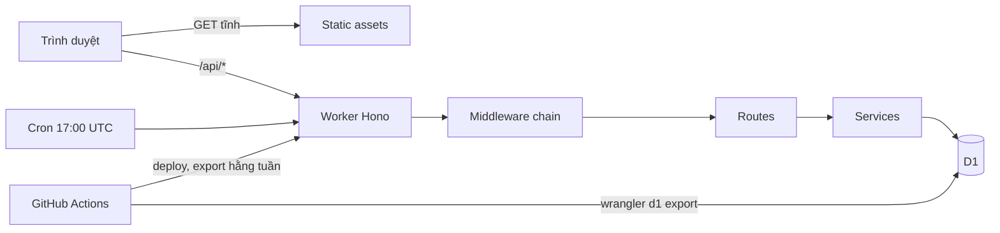

# Kiến trúc hệ thống

Một Cloudflare Worker phục vụ cả API (Hono) và giao diện React (file tĩnh), dữ liệu trong D1 (SQLite). Spec nghiệp vụ: `spec.md`.

## 1. Thành phần

| Thành phần | Công nghệ | Vị trí |
|---|---|---|
| API | Hono + Zod + Drizzle (chỉ để query có kiểu) | `src/worker` |
| Giao diện | React 19, React Router, TanStack Query, react-hook-form | `src/client` |
| Hợp đồng dùng chung | Zod schema, enum, quy tắc danh hiệu, validator import | `src/shared` |
| Dữ liệu | D1, migration SQL thuần | `migrations/` |
| Cron | Dọn phiên hết hạn, `0 17 * * *` UTC | `src/worker/cron` |
| Build/Deploy | Vite + `@cloudflare/vite-plugin`, Wrangler | `wrangler.jsonc` |

## 2. Luồng request

`assets.run_worker_first = ["/api/*"]`: mọi đường khác trả file tĩnh (SPA fallback), chỉ `/api/*` vào Worker. Chuỗi middleware trong `src/worker/app.ts`, theo thứ tự:

1. `apiSecurityHeaders` (CSP chặt, HSTS, nosniff, DENY framing)
2. `originCheck` (chặn CSRF: request ghi phải đúng Origin)
3. `apiBodyLimit` 256 KB; `authBodyLimit` 5 KB cho `/api/auth/*`
4. `sessionAuth` (đọc cookie, nạp người dùng và vai trò)
5. `mustChangePasswordGate` (còn cờ đổi mật khẩu chỉ gọi được `/api/me`, đổi mật khẩu, đăng xuất)
6. `requireRole` theo từng router, rồi route -> service -> D1

Lỗi đi qua `handleError` (`lib/error-handler.ts`), trả `{ error: { code, message } }`; lỗi trigger/UNIQUE của D1 được ánh xạ sang thông báo tiếng Việt.

## 3. Xác thực và phiên

- Mật khẩu: PBKDF2-SHA256, 100000 vòng (trần của workerd), chuỗi `pbkdf2$sha256$<n>$<salt>$<hash>` nên đổi n được sau này.
- Cookie `__Host-sid`: HttpOnly, Secure, SameSite=Strict, TTL 8 giờ trượt, tối đa 7 ngày từ lúc đăng nhập (`sessions.created_at`). DB chỉ lưu SHA-256 của token (`sessions.token_hash`). Gia hạn trượt khi phiên cũ hơn 15 phút; cron xóa phiên hết hạn.
- Khóa tài khoản: 5 lần sai -> khóa 15 phút. `login-attempt-guard.ts` đặt trước lượt thử bằng một `UPDATE` có điều kiện (nguyên tử) **trước** khi băm, nên request song song không vượt được ngưỡng. Admin mở khóa tạm qua PUT user. Tài khoản đang khóa hoặc bị vô hiệu: server vẫn băm và so mật khẩu, sai -> 401 chung (giống user không tồn tại), đúng -> 423; không ghi D1, không kéo dài khóa. `login-rate-limit-middleware.ts` giới hạn 10 request/60s theo `CF-Connecting-IP` bằng binding `LOGIN_LIMITER` (`ratelimits` trong `wrangler.jsonc`, namespace_id 1001 prod, 1002 staging); vắng binding hoặc IP thì bỏ qua, lỗi binding thì cho qua (fail open). Mọi `/api/*` trả `Cache-Control: no-store`.
- Vai trò: ADMIN (toàn bộ), EDITOR (xem, thêm/sửa/xóa khen thưởng, import), VIEWER (chỉ xem). Ma trận ở `src/shared/role-permissions.ts`, kiểm thử bằng các file `rbac-matrix-*.test.ts`.
- Mọi thao tác ghi và đăng nhập ghi vào `audit_logs`.

## 4. Mô hình dữ liệu (tóm tắt)

14 bảng (13 theo spec + `award_counters`). Chi tiết cột: `spec.md` §7, DDL: `migrations/`.

| Nhóm | Bảng |
|---|---|
| Danh mục | `units`, `teams`, `ranks`, `positions`, `authorities`, `award_types`, `award_variants` |
| Hệ thống | `users`, `sessions` |
| Nghiệp vụ | `officers`, `awards` (trung tâm), `import_batches`, `audit_logs` |
| Thống kê | `award_counters` |

- Xóa mềm bằng `deleted_at` cho `officers` và `awards`; index một phần `WHERE deleted_at IS NULL`.
- Ràng buộc chéo bảng bằng **trigger** (đội thuộc đơn vị, danh hiệu hợp đối tượng, huân chương có loại, chặn xóa đơn vị/đội đang dùng, `imported_rows <= total_rows`). Ghi nhiều câu lệnh dùng `db.batch()` (atomic, rollback khi một câu lỗi).
- Migration: 0001 schema, 0002 seed danh mục, 0003 `award_counters` + index danh sách, 0004 trigger chặn quá số dòng của đợt import.

## 5. Chiến lược giới hạn D1 free

Giới hạn: 5 triệu dòng đọc, 100 nghìn dòng ghi mỗi ngày; tối đa 100 tham số bind mỗi câu; CPU Worker thấp.

- Danh sách luôn phân trang SQL (`size` tối đa 50) và đi theo index một phần (`ix_awards_list`, `ix_awards_unit_list`, `ix_awards_unit_team`, ...). Test `awards-list-query-plan.test.ts` và `d1-read-meter.ts` canh số dòng đọc.
- **`award_counters`**: thống kê F01 (`stats`) đọc từ bảng đếm `(unit_id, team_id, award_type_id, subject) -> n`, do 4 trigger trên `awards` tự cập nhật, thay vì `COUNT(*)` quét toàn bảng. `team_id = 0` là cấp đơn vị.
- Tìm theo tên dùng `LIKE` trên cột đã chuẩn hóa (`full_name_search`, `decision_number_search`) và phải quét; dưới ~10.000 bản ghi chấp nhận được. Vượt thì chuyển FTS5 (xem roadmap).
- Import: tối đa 5 MB, 100 dòng mỗi file, gửi từng lô 30 dòng; mỗi lô là một `db.batch`. Đã kiểm trên staging: batch tới 500 câu lệnh vẫn qua.
- Bulk insert và `IN (...)` được chia nhỏ để không vượt 100 tham số.
- CPU: chỉ login và đổi mật khẩu băm PBKDF2 (tối đa 2 lần mỗi request); các endpoint khác nhẹ.

## 6. Bảo mật triển khai

Chỉ HTTPS; `public/_headers` đặt CSP/HSTS cho file tĩnh, Worker đặt cho `/api/*`. Backup luôn mã hóa age. Rate limit WAF cho đăng nhập chờ custom domain (xem `deployment-guide.md` §8).
